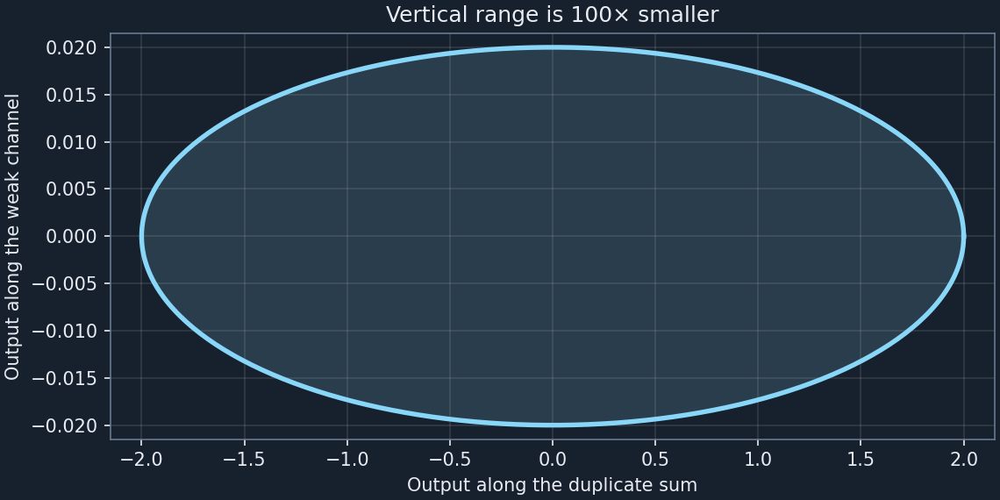

# Singular value decomposition

A calibration array can hide a direction even when each coordinate separately appears in a reading. It can also detect a direction so weakly that a small sensor error dominates the signal. Singular values distinguish these cases by measuring gains between orthonormal input and output coordinates.

In an original four-channel model, the first two sensors duplicate a sum, a third reads a weak actuator, and the fourth has no modeled response. Let $x=(x_1,x_2,x_3)^T$ be the real, dimensionless command, and write $Ax$ for its output. For $0<\varepsilon<1$ the response matrix is

$$
A=\begin{pmatrix}
1&1&0\\
1&1&0\\
0&0&\varepsilon\\
0&0&0
\end{pmatrix}.
$$

## Rectangular maps have directional gains ([L74 01:03](https://www.youtube.com/watch?v=7wDQOLHLu-I&t=63s))

For this section take a general $A\in\mathbb C^{m\times n}$ with positive dimensions, and use $A^*$ for the adjoint. The Euclidean norm is $\|x\|_2=\sqrt{x^*x}$. Define the singular values $\sigma_1\geq\cdots\geq\sigma_p\geq0$, where $p=\min(m,n)$, as the square roots of the $p$ largest eigenvalues of $A^*A$, counting multiplicity. If $n>m$, the extra $n-m$ eigenvalues are zero because the rank of $A^*A$ is at most $m$. The eigenvalues are real and nonnegative because $A^*A$ is Hermitian and $x^*A^*Ax=\|Ax\|_2^2\geq0$.

In the calibration array, the first two columns agree, so the difference direction $(1,-1,0)^T/\sqrt{2}$ has zero gain. The unit sum direction $(1,1,0)^T/\sqrt2$ has gain $2$. The unit third-coordinate direction has gain $\varepsilon$. The respective images are either zero or orthogonal. Direct multiplication gives the same conclusion: the top-left $2$-by-$2$ block of $A^*A$ has every entry equal to $2$, so its eigenvalues are $4$ and $0$, and the remaining eigenvalue is $\varepsilon^2$.

## Two independent changes of coordinates ([L75 00:31](https://www.youtube.com/watch?v=15E5p2M_uv4&t=31s))

The **singular value decomposition** is $A=U\Sigma V^*$ with unitary $U$ of order $m$ and unitary $V$ of order $n$. A unitary matrix has orthonormal columns and inverse equal to its adjoint. The rectangular $m$-by-$n$ matrix $\Sigma$ has $\sigma_j$ in diagonal positions $j\leq p$ and zeros elsewhere. The two coordinate systems may have different dimensions.

One construction uses the Hermitian spectral theorem from [Chapter 12](ch12.html). Choose an orthonormal eigenbasis $v_1,\dots,v_n$ of $A^*A$ ordered by decreasing eigenvalue. For every $\sigma_j>0$ set $u_j=Av_j/\sigma_j$. Then

$$
u_i^*u_j=\frac{v_i^*A^*Av_j}{\sigma_i\sigma_j}
=\frac{\sigma_j^2}{\sigma_i\sigma_j}v_i^*v_j.
$$

For positive singular values this equals one when $i=j$ and zero otherwise. If $A^*Av_j=0$, then the squared norm of $Av_j$ vanishes, so $Av_j=0$. Complete the nonzero-image vectors $u_j$ to an orthonormal basis of the output space, for example by Gram–Schmidt. The matrices $U$ and $V$ with these ordered columns satisfy $AV=U\Sigma$ column by column. Multiplication by $V^*$ gives the factorization, including the case $A=0$.

The construction proves existence. A numerical SVD typically works from the entries of $A$ directly by unitary reduction to bidiagonal form, followed by the SVD of the smaller banded problem. This avoids explicitly forming the Gram matrix $A^*A$, where the ratio of the largest to smallest positive eigenvalues is the square of the corresponding singular-value ratio. [LAPACK Users’ Guide, Singular Value Decomposition](https://www.netlib.org/lapack/lug/node53.html)

## The partition reveals four subspaces ([L76 02:00](https://www.youtube.com/watch?v=hy_2HezdzQo&t=120s))

Let $r$ be the number of strictly positive singular values. Write $U=(U_1\ U_2)$ and $V=(V_1\ V_2)$, with $r$ columns in each leading block. Set $D=\operatorname{diag}(\sigma_1,\dots,\sigma_r)$. The compact decomposition is $A=U_1DV_1^*$. The product sends each $v_j$ in $V_1$ to $\sigma_ju_j$, which spans the range as $j$ varies. Vectors in $V_2$ go to zero. The adjoint factorization swaps the roles of $U$ and $V$. In particular $A^*u_j=\sigma_jv_j$ for every positive gain, so $AA^*u_j=\sigma_j^2u_j$ and $AA^*$ vanishes on the span of $U_2$. Together these observations prove that $r=\operatorname{rank}A$ and identify four orthonormal bases.

| Space | Basis columns | Calibration meaning |
| --- | --- | --- |
| $\mathcal R(A)$ | $U_1$ | Output sum and weak reading |
| $\ker A^*$ | $U_2$ | Disagreement between duplicate readings and the fourth channel |
| $\mathcal R(A^*)$ | $V_1$ | Input sum and weak actuator |
| $\ker A$ | $V_2$ | Invisible change in input contrast |

For any prescribed output $b$, the equation $Ax=b$ becomes $\Sigma V^*x=U^*b$. Thus an exact solution exists precisely when $U_2^*b=0$. In that case every solution has the form $V_1 D^{-1}U_1^*b+V_2z$, with $z$ arbitrary. Every solution has the same observable part. The hidden component alters the command without affecting any predicted reading.

## Gains, conditioning, and discarding a direction ([L77 05:00](https://www.youtube.com/watch?v=dZbuA6P_WvE&t=300s))

For a vector $x$, set $c=V^*x$. Unitary matrices preserve lengths, so

$$
\|Ax\|_2^2=\sum_{j=1}^r\sigma_j^2|c_j|^2,
\qquad \|x\|_2^2=\sum_{j=1}^n |c_j|^2.
$$

The induced Euclidean norm $\|A\|_2=\max_{\|x\|_2=1}\|Ax\|_2$ is therefore $\sigma_1$, attained at $v_1$. For square invertible $A$, the inverse has singular values given by the reciprocals in reverse order, so the condition number $\|A\|_2\|A^{-1}\|_2$ is $\sigma_1/\sigma_n$. For the rectangular calibration array the inverse is defined only between the observable input and attainable output spaces. On those spaces the ratio is $2/\varepsilon$, and unit error in the weak reading produces an error of $1/\varepsilon$ in the inferred actuator.

The same coordinates describe output geometry. On the observable input subspace the unit sphere maps to an ellipsoid surface whose semiaxes have lengths $\sigma_j$. If the kernel is nonzero, the image of the full unit sphere fills that ellipsoid, since adding a kernel component can increase the input length to one without changing the output. If $r=0$, the image consists of zero.

<figure>

<figcaption>The image of the full unit sphere fills the ellipse for the calibration array. The two axes use different scales to expose the weak gain.</figcaption>
</figure>

[L77 22:30](https://www.youtube.com/watch?v=dZbuA6P_WvE&t=1350s)

For a lower-rank approximation, let $A_k=\sum_{j=1}^k\sigma_j u_jv_j^*$ with $0\leq k<r$. The singular values of the omitted terms show that $\|A-A_k\|_2=\sigma_{k+1}$. Every matrix $B$ of rank at most $k$ vanishes on some unit vector in the span of the first $k+1$ right singular vectors, since the restriction to that subspace has rank at most $k$. For this vector $\|(A-B)x\|_2=\|Ax\|_2\geq \sigma_{k+1}$. The truncated SVD is therefore optimal in induced Euclidean norm. In the calibration array its best rank-one truncation has error $\varepsilon$. A truncation changes the model's effective rank and intentionally suppresses a real response.

## Laboratory

Run [the SVD experiment](../code/ch19.py) with no input files. It uses $\varepsilon=0.02$, checks reconstruction from the two positive singular terms and checks both null spaces, and prints two nonzero gains $2$ and $0.02$. It verifies rank-one error $0.02$ and observable gain ratio $100$. It compares subspaces by an orthogonal projection so that arbitrary basis signs and rotations do not change the check.

## Exercises with solutions

### Squaring gains

**Problem.** Find the singular values of the row $(3,4)$ and give a unit right singular vector for the nonzero value.

**Solution.** Its Gram matrix is the outer product of $(3,4)^T$ with itself. It acts on this vector by multiplication by $3^2+4^2=25$ and vanishes on the orthogonal direction. There is one listed singular value because $p=1$. Its value is $5$, and one right singular vector is $(3,4)^T/5$.

### Detect inconsistent data

**Problem.** Can the calibration array produce $b=(1,2,0,0)^T$ exactly?

**Solution.** No. The unit output direction $(1,-1,0,0)^T/\sqrt2$ lies in $\ker A^*$. Its inner product with $b$ is $-1/\sqrt2$ and its inner product with every $Ax$ is zero.

### Adjust the observable basis

**Problem.** If two positive singular values agree, explain how to rotate their right singular vectors while maintaining the SVD.

**Solution.** Let the two pairs be the columns of $U_J,V_J$ with common value $\sigma$. For any $2$-by-$2$ unitary $W$, replace them with $U_JW,V_JW$. The contribution becomes $(U_JW)\sigma I_2(V_JW)^*=\sigma U_JWW^*V_J^*=\sigma U_JV_J^*$. Each rotated pair remains orthonormal.

### Separate operator error from inverse error

**Problem.** Drop the weak singular direction from the calibration model. Compare the response error on $x=(0,0,1)^T$ with the command error if the truncated model reconstructs a zero weak actuator.

**Solution.** The command has only the omitted direction, so the discarded output is $(0,0,\varepsilon,0)^T$ and has length $\varepsilon$. Setting the reconstructed coordinate to zero changes the command by one. Small operator approximation error does not bound the error in an inverse solution along a weak direction.
