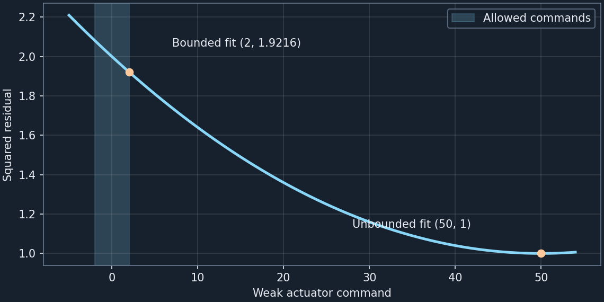

# Pseudoinverses and constrained least squares

A calibration array whose first two readings duplicate a sum can explain some parts of a measurement precisely. If one channel has no modeled response, exact reconstruction may be impossible. If a second channel barely responds, an excellent fit may require issuing an actuator command far beyond its allowable range. Unconstrained least squares picks the closest modeled reading. A command budget may force a different reading, so constrained least squares minimizes the residual over commands that meet the budget.

Use real commands and the original array from [Chapter 19](ch19.html), with weak gain $\varepsilon=0.02$ and observed vector $b=(2,2,1,1)^T$. The first two rows of $A$ read $x_1+x_2$, the third reads $\varepsilon x_3$, and the last is zero. All quantities in this example are dimensionless.

## A generalized inverse extracts the reconstructible component ([L78 01:01](https://www.youtube.com/watch?v=QMeuDyN07dg&t=61s))

For $A\in\mathbb C^{m\times n}$, write its compact singular value decomposition as $A=U_1DV_1^*$, with $D$ the diagonal block of strictly positive singular values, $U_1,V_1$ the paired orthonormal columns, and $*$ the adjoint. Define the **Moore–Penrose pseudoinverse** by $A^+=V_1D^{-1}U_1^*$, with the zero matrix as the result if the rank is zero. This is an $n$-by-$m$ matrix that reverses nonzero gains after projecting out unattainable measurements.

The four defining identities are

$$
AA^+A=A,\qquad A^+AA^+=A^+,\qquad
(AA^+)^*=AA^+,\qquad (A^+A)^*=A^+A.
$$

Multiplication gives $AA^+=U_1U_1^*$ and $A^+A=V_1V_1^*$. These are orthogonal projections onto the range of $A$ and the range of $A^*$, respectively, which proves the identities directly. To see uniqueness, suppose $G$ satisfies the same identities. Then $AG$ is Hermitian and idempotent, and $AGA=A$ makes its range equal to $\mathcal R(A)$. Also $GA$ is Hermitian and idempotent, with kernel $\ker A$ because $GAv=0$ implies $Av=AGAv=0$. It follows that $GA$ is the orthogonal projection onto $(\ker A)^\perp$. Since $G=GAG$, every value $Gb$ is in $(\ker A)^\perp$, and $A(Gb)$ equals the projection of $b$ onto $\mathcal R(A)$. There is exactly one such $Gb$, since $A$ maps $(\ker A)^\perp$ bijectively to $\mathcal R(A)$.

For the array, the first two entries of $b$ already agree and its third is attainable by a large command. The fourth-channel component $(0,0,0,1)^T$ lies in $\ker A^*$. Thus $A^+b=(1,1,50)^T$. This illustrates two different actions of the pseudoinverse: discarding an impossible reading and amplifying the weak attainable reading.

## The residual is orthogonal to all attainable changes ([L79 13:32](https://www.youtube.com/watch?v=F1lZtVJK3qc&t=812s))

The least-squares problem minimizes $\|Ax-b\|_2^2$ over $x$. Let $P=AA^+$ be the projection onto $\mathcal R(A)$. The decomposition

$$
Ax-b=(Ax-Pb)-(I_m-P)b
$$

splits the residual into orthogonal components. The second is independent of $x$. The first can be made zero, so the least-squares minimizers are exactly the solutions of $Ax=Pb$. This is equivalent to the **normal equations** $A^*Ax=A^*b$, since they say the residual lies in $\ker A^*$. The residual is unique even if the coefficient vector varies.

Every minimizer has the form $A^+b+z$ with $z\in\ker A$. The two terms are orthogonal, so $\|A^+b+z\|_2^2=\|A^+b\|_2^2+\|z\|_2^2$. The pseudoinverse chooses the unique minimum-length coefficient vector, and the least-squares problem itself has a unique minimizer precisely if $A$ has full column rank. For the array the residual at $A^+b$ is $(0,0,0,-1)^T$. Substituting $x_1=1+t,x_2=1-t$ leaves the residual unchanged and adds $2t^2$ to the squared command length.

The normal equations characterize the minimizer in exact arithmetic. For full column rank, their coefficient matrix has a Euclidean condition number that is the square of the singular-value ratio of $A$. Explicit Gram formation can therefore lose information about weak directions. Full-rank QR and rank-aware SVD solve the original residual problem through orthogonal transformations. A rank threshold used in computation is a modeling decision when the smallest gains are comparable with uncertainty. [LAPACK Users’ Guide, Linear Least Squares](https://www.netlib.org/lapack/lug/node27.html)

## Constrain a second prediction ([L80 01:01](https://www.youtube.com/watch?v=yYeqLnta8zs&t=61s))

Let $B\in\mathbb C^{p\times n}$ describe a second linear observation, $d\in\mathbb C^p$ its target, and $\alpha\geq0$ the permitted deviation. Require $\|Bx-d\|_2\leq\alpha$ while minimizing $\|Ax-b\|_2^2$. The smallest possible constraint residual is $\|(I_p-BB^+)d\|_2$ by the preceding projection argument. This supplies a feasibility check independent of $A$.

Assume temporarily that $\ker A\cap\ker B=\{0\}$. This removes directions that neither term can see. Let $G=A^*A+B^*B$. Its quadratic form is $\|Ax\|_2^2+\|Bx\|_2^2$, so $G$ is positive definite under the assumption. Let $G^{-1/2}$ denote the inverse of its positive square root. The Hermitian matrix $G^{-1/2}A^*AG^{-1/2}$ has a unitary eigenbasis matrix $W$. Set $X=G^{-1/2}W$. Then

$$
X^*A^*AX=\operatorname{diag}(a_j^2),\qquad
X^*B^*BX=I_n-\operatorname{diag}(a_j^2)=\operatorname{diag}(c_j^2),
$$

where $a_j,c_j\geq0$ and $a_j^2+c_j^2=1$ for each $j$. The columns of $AX$ are mutually orthogonal where nonzero, as are those of $BX$. Normalizing these columns gives separate orthonormal output directions for the two matrices. This construction displays the mechanism of the **generalized singular value decomposition** in the joint full column rank case. The input change $X$ is invertible and need not preserve Euclidean lengths. If the matrices share a null space, the same construction can be applied on its orthogonal complement. Commands still have arbitrary components in the shared null space.

Write $x=Xy$. For $a_j>0$, let $\beta_j$ be the coordinate of $b$ along column $j$ of $AX$ normalized to length one. For $c_j>0$, define $\gamma_j$ from $d$ and $BX$ in the same way. Assign zero to unused coordinates. The objective and constraint squared are then $\sum_j|a_jy_j-\beta_j|^2$ and $\sum_j|c_jy_j-\gamma_j|^2$ plus their respective fixed orthogonal residuals. This reduces the joint problem to independent scalar terms coupled only by the allowed total constraint residual.

For a multiplier $\lambda>0$, minimizing $\|Ax-b\|_2^2+\lambda\|Bx-d\|_2^2$ gives

$$
y_j(\lambda)
=\frac{a_j\beta_j+\lambda c_j\gamma_j}{a_j^2+\lambda c_j^2}.
$$

Every denominator is positive on the joint observable space. The constraint residual is nonincreasing with $\lambda$: for two multipliers, use optimality of each penalized solution against the other, then add the two inequalities. Equivalently, for $a_j,c_j>0$, the remaining scalar constraint error is $a_j(c_j\beta_j-a_j\gamma_j)/(a_j^2+\lambda c_j^2)$ and its magnitude decreases whenever it is nonzero.

If an unconstrained minimizer is feasible, choose it. To test feasibility among several minimizers, use the free objective coordinates to minimize the constraint residual. If the best unconstrained minimizer violates the constraint and some point satisfies it strictly, continuity gives a positive $\lambda$ with residual exactly $\alpha$. The limit at $\lambda\downarrow0$ is the smallest constraint residual among unconstrained minimizers, and the limit at infinity is the global minimum constraint residual. Penalized optimality at this $\lambda$ implies constrained optimality: a feasible point with lower objective would also have a lower penalized value, since its constraint value cannot exceed the boundary solution's.

In the array, choose $B=(0,0,1)$, $d=0$, and $\alpha=2$. For fixed $x_3$, take $x_1+x_2=2$. The unconstrained $x_3=50$ exceeds the limit. On the interval $[-2,2]$, $(0.02x_3-1)^2$ decreases as $x_3$ increases. Thus $x_3=2$ is optimal. Choosing $x_1=x_2=1$ minimizes command length among the tied constrained solutions. The squared residual increases from $1$ to $1.9216$.

<figure>

<figcaption>After fixing the sum of the first two commands, the actuator limit moves the optimum from the stationary point at 50 to the feasible boundary at 2.</figcaption>
</figure>

## Handle exact constraints separately ([L80 20:00](https://www.youtube.com/watch?v=yYeqLnta8zs&t=1200s))

For $Bx=d$, first check $d\in\mathcal R(B)$. Choose a feasible $x_0=B^+d$ and let $Z$ have orthonormal columns spanning $\ker B$. Every feasible vector is $x=x_0+Zz$, where $z$ is a free coefficient vector. Determine $z$ by minimizing $\|(AZ)z-(b-Ax_0)\|_2^2$. Existence follows from ordinary least squares, and uniqueness holds if and only if $\ker A\cap\ker B=\{0\}$. When $\alpha$ equals the strictly positive minimum possible constraint residual, use this same reduction with $d$ replaced by $BB^+d$, since all feasible points attain the least possible value of $\|Bx-d\|_2$. [LAPACK Users’ Guide, Equality-Constrained Least Squares](https://www.netlib.org/lapack/lug/node28.html)

## Laboratory

Run [the constrained reconstruction experiment](../code/ch20.py). It checks all four pseudoinverse identities, computes the minimum-length unconstrained and constrained commands, and checks that the residual is orthogonal to attainable variations for the unconstrained solution. The constraint increases the squared residual from $1$ to $1.9216$ and reduces the third command from $50$ to $2$.

## Exercises with solutions

### Pseudoinverse of a row

**Problem.** For the real row $A=(3,4)$, derive $A^+$ and give the minimum-length command producing output $10$.

**Solution.** Its gain is $5$, its unit right singular vector is $(3,4)^T/5$, and its left vector can be the scalar $1$. Then $A^+=(3,4)^T/25$ and $10A^+=(6/5,8/5)^T$. Any other command producing $10$ differs by a vector orthogonal to this command because the difference belongs to the kernel.

### A constraint can be infeasible by itself

**Problem.** Let $Bx=(x,x)^T$ with real scalar $x$ and let $d=(0,2)^T$. Find the smallest feasible $\alpha$.

**Solution.** Minimize $x^2+(x-2)^2=2(x-1)^2+2$. The minimum occurs at $x=1$ and gives residual $\sqrt2$. This bound is independent of the measured response $Ax$.

### The multiplier in the actuator example

**Problem.** Find the positive multiplier for the upper bound $|x_3|\leq2$.

**Solution.** Differentiating $(\varepsilon x_3-1)^2+\lambda x_3^2$ gives $x_3=\varepsilon/(\varepsilon^2+\lambda)$. Substituting $x_3=2$ yields $\lambda=\varepsilon/2-\varepsilon^2=0.0096>0$. Equality of the boundary residual and the positive penalty imply the optimality argument in the preceding section.

### Constraints and uniqueness

**Problem.** Keep the array but require $x_1-x_2=0$. Does this remove all ties among least-squares minimizers?

**Solution.** Yes. The kernel of $A$ consists of multiples of $(1,-1,0)^T$. Evaluating $B=(1,-1,0)$ on this direction gives $2$, so the kernels intersect only in zero. The original pseudoinverse command already satisfies the constraint and is now the unique constrained minimizer.
